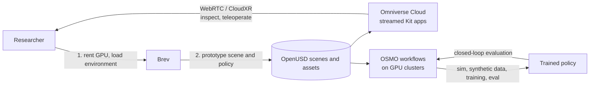

# NVIDIA Cloud & 3D Infrastructure

> [!summary] In short
> Simulation-based robotics research runs into three practical problems: you need a GPU, a working environment on it, and a way to run many jobs on many GPUs. NVIDIA's cloud stack handles each one with a separate tool. [[NVIDIA Brev]] hands out GPU instances, [[NVIDIA Omniverse Cloud]] hosts and streams OpenUSD-based simulation apps, and [[NVIDIA OSMO]] schedules the multi-stage pipelines on top. They are separate products, and OpenUSD is the data format that connects most of the workflow. The question behind the whole note is simple: what does it take to run robot simulation without owning the hardware?

## Scope

This cluster covers Part 1 of the seminar, infrastructure and orchestration. The simulators themselves are left for Part 2. Here they only appear as workloads that the infrastructure has to run.

## How they fit together

This diagram is my own reading of how the tools combine, not an official NVIDIA architecture. In practice each one can be used on its own, and nothing forces you to adopt all three.

## Notes in this cluster

- [[NVIDIA Omniverse Cloud]]: hosted 3D and simulation apps, OpenUSD, remote streaming
- [[NVIDIA Brev]]: on-demand GPU instances and Launchables
- [[NVIDIA OSMO]]: workflow orchestration for physical AI pipelines

A reasonable reading order follows the life of a project: Brev first (getting a machine), then OSMO (scaling up), then Omniverse Cloud (looking at and interacting with results).

## Comparison

| | Omniverse Cloud | Brev | OSMO |
|---|---|---|---|
| Main job | Run and stream 3D / simulation apps | Provision a ready GPU environment | Orchestrate multi-stage workloads |
| Unit of work | Streamed application session | Instance or Launchable | YAML workflow of tasks |
| Where it runs | NVIDIA-managed (DGX Cloud, Azure) | Several third-party clouds | Any Kubernetes cluster, cloud or on-prem |
| Delivery model | Managed service | Managed rental | Open-source software you deploy |
| Typical moment | Review, collaborate, teleoperate | First day on a project | Scaling an experiment to many runs |
| Key tech | OpenUSD, WebRTC, CloudXR | CUDA, Docker, Launchables | Kubernetes, group scheduling |

## Key terms

| Term | Meaning in this context |
|---|---|
| OpenUSD | Scene description format built from composable layers |
| WebRTC | Browser-native protocol used to stream rendered frames and send input back |
| CloudXR | NVIDIA's streaming SDK for XR devices and OpenXR applications |
| Launchable | Shareable Brev link bundling hardware, software and code |
| Workflow | An OSMO YAML file describing tasks, dependencies and resources |

## Open questions for discussion

- How much latency can teleoperation tolerate over WebRTC or CloudXR, and who has measured it on real setups?
- At the scale of a research lab, does renting GPUs stay cheaper than owning them? I have not checked current pricing.
- How portable is an OSMO workflow between clusters once real data and credentials are involved?

## Sources

- [NVIDIA Omniverse on DGX Cloud](https://www.nvidia.com/en-eu/data-center/omniverse-dgx-cloud/)
- [NVIDIA Brev documentation](https://docs.nvidia.com/brev/latest)
- [OSMO user guide](https://nvidia.github.io/OSMO/main/user_guide/index.html)
- [OpenUSD documentation](https://openusd.org)