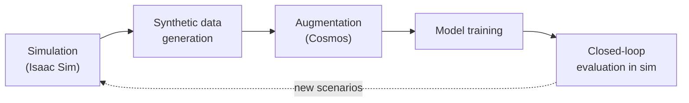

# NVIDIA OSMO

Part of [[NVIDIA Cloud & 3D Infrastructure]]. In the overall workflow it takes a prototype (for example one built on a Brev instance) and runs it at scale, and its outputs can be inspected in a streamed Omniverse session.

## What it is

An open-source workflow orchestration platform for physical AI and robotics, developed in the NVIDIA/OSMO repository on GitHub. The whole pipeline is written as declarative YAML and submitted from the CLI or a web UI. OSMO then coordinates the tasks, their dependencies and the resources they need.

The user guide describes a four-step loop: write the workflow, submit it, let OSMO execute the tasks, and iterate on the results. There is also an interactive mode. In NVIDIA's synthetic data tutorial, a workflow starts a container with Isaac Sim, and the user forwards the required ports to it to record trajectories by hand.

## Heterogeneous compute

Physical AI work mixes training GPUs, RTX GPUs for rendering simulation, and edge devices for hardware-in-the-loop tests. The user guide describes group scheduling, which runs training, simulation and edge testing together inside one workflow.

OSMO targets Kubernetes: EKS, AKS, GKE, on-premises and air-gapped clusters. The docs claim the same workflow moves from a workstation to a cluster with no code changes. That is a vendor claim and worth testing.

## The pipeline

The diagram is illustrative. NVIDIA's developer blog shows two concrete pieces: an interactive OSMO workflow that records trajectories in Isaac Sim (MobilityGen), and a second workflow that applies Cosmos Transfer augmentation to them. The Physical AI Data Factory Blueprint, announced at GTC, positions OSMO as the layer that unifies the generate, augment and evaluate steps. Microsoft's open physical AI toolchain also builds on OSMO, combining it with Azure Machine Learning for multi-node training.

"Closed-loop evaluation" is my own label for a stage that runs the trained policy back in simulation. The OSMO docs themselves speak of training, simulation and hardware-in-the-loop testing.

## Storage

Datasets are content-addressable with automatic deduplication. The docs claim 10 to 100 times lower storage cost, which I would treat as a best case. Deduplication helps most when many runs share a large base dataset and differ only in small augmentations.

## Where it sits

OSMO does not replace Kubernetes or a GPU scheduler. NVIDIA's reference architecture for physical AI pairs Run:ai for resource management with OSMO for workflow execution. A useful mental split is that the scheduler decides who gets which GPU, while OSMO decides which task runs when, and with what inputs.

## Limits

- Scaling needs a Kubernetes cluster, which is real operational work.
- Each stage needs a container image.
- The project moves quickly (the docs list many releases), so check the version before quoting details.
- Credentials for registries and model downloads still have to be set up per environment.

## Sources

- [OSMO user guide](https://nvidia.github.io/OSMO/main/user_guide/index.html)
- [OSMO on GitHub](https://github.com/NVIDIA/OSMO)
- [NVIDIA blog: synthetic data pipelines with Isaac Sim](https://developer.nvidia.com/blog/build-synthetic-data-pipelines-to-train-smarter-robots-with-nvidia-isaac-sim)
- [Physical AI reference architecture: overview](https://docs.nvidia.com/enterprise-reference-architectures/physical-ai-reference-architecture-deployment-guide/latest/overview.html)
- [Physical AI reference architecture: workflow](https://docs.nvidia.com/enterprise-reference-architectures/physical-ai-reference-architecture-deployment-guide/latest/physical-ai-workflow.html)
- [Microsoft physical AI toolchain: architecture](https://microsoft.github.io/physical-ai-toolchain/contributing/architecture)