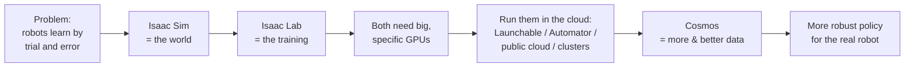

# 00 Index – Isaac Sim, Isaac Lab and Cosmos in the Cloud

## English

**Category:** map of content (MOC) for Part 2 of the seminar. **Relevance:** entry point for everything about *running* NVIDIA's robot simulation, robot training and world-model workloads on cloud resources.

### Scope

This folder collects the research behind Part 2 of the seminar *"Using cloud services to train and simulate robot models"*. Part 1 explains the **platform layer** (Omniverse, OpenUSD, streaming, Brev, OSMO). This part explains the **workloads** that run on top of it, and **how to get them running in the cloud**:

- **Isaac Sim** – the simulated world (physics + sensors + rendering).
- **Isaac Lab** – the robot-learning framework (thousands of robots training in parallel).
- **Cosmos** – world foundation models that generate more diverse, realistic training data.

Research date: **November 2026**. Versions referenced: Isaac Sim 6.x (docs 6.2.0), Isaac Lab 3.0, Isaac Launchable v1.7, Isaac Automator v4.6.x, Cosmos 3. These products change quickly – check the linked sources before reusing numbers.

### Red line

### Key message in one sentence

"Isaac Sim builds the world, Isaac Lab trains thousands of robots in parallel in it, and Cosmos makes the data more realistic – all three need big and *different* GPUs, which is exactly why renting them on demand in the cloud makes sense."

---
