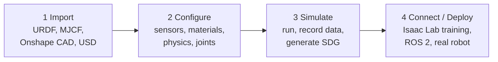

# 01 Isaac Sim

## English

**Category:** open-source robot simulator (physics, sensors, photoreal rendering), built on Omniverse/OpenUSD. **Relevance:** high – it is the "world" in which robots are tested and trained; the base layer for [[02-Isaac-Lab]] and the data source for [[07-Cosmos-World-Foundation-Models]].

### What it is

Isaac Sim is NVIDIA's reference application for robot simulation. Current documentation: version **6.2.0** (research date). It is **open source under Apache 2.0** and built on **OpenUSD** (the scene description format presented in Part 1). It combines:

- **Physics:** *calculates* gravity, contacts, friction, joints and actuators. Backends: **PhysX** (classic) and **Newton** (new, GPU/Warp-based, open source).
- **Sensors and rendering:** simulated RGB and depth cameras, LiDAR, IMU, contact sensors, rendered with **RTX ray tracing** so camera images look realistic.
- **Replicator:** synthetic data generation (SDG) – render labelled images (bounding boxes, segmentation, depth) for perception training.
- **OmniGraph:** visual/node-based scripting of behaviours and data flows.
- **ROS 2 bridge:** connects the simulated robot to the same robot software (ROS 2 nodes) that runs on the real robot ("software-in-the-loop").

### Typical workflow

The docs describe four steps:

- **Robot formats:** URDF (common robot description in ROS), MJCF, Onshape CAD, native USD.
- **Ecosystem path recommended by NVIDIA:** Isaac Sim → Isaac Lab (learning) → Isaac Lab Arena (policy benchmarking) → software-in-the-loop (SIL) testing.

### Ways to run it

| Mode | Command / form | Cloud relevance |
|---|---|---|
| Desktop app (GUI) | `./isaac-sim.sh` | Needs a screen → only via remote desktop in the cloud |
| Headless + streaming | `./isaac-sim.streaming.sh` or `./runheadless.sh` (container) | Standard for cloud VMs, see [[04-Remote-Access-and-Streaming]] |
| Newton + streaming | `./isaac-sim.newton.streaming.sh` | Same, with Newton physics instead of PhysX |
| Container | `nvcr.io/nvidia/isaac-sim:6.2.0` (Linux only) | Portable unit for any GPU VM |
| Python / pip | `isaacsim` Python packages, standalone scripts | Scripted, batch-style runs |

### Why it matters for the cloud

- It needs **RTX GPUs with RT cores** and lots of VRAM/RAM → [[03-Hardware-and-GPU-Selection]].
- It is a **graphical** application, but cloud servers have no monitor → it runs **headless** and the picture is **streamed** to the user ("only pixels travel to the laptop").
- NVIDIA's docs list many cloud targets: Isaac Launchable, Brev, AWS, Azure, GCP, Tencent, Alibaba, Volcano Engine, Baidu, remote workstation, plus [[06-Isaac-Automator]].

### Strengths

- Physically based simulation **and** photoreal sensors in one tool.
- Open source, OpenUSD-based, ROS 2 integration, many robot importers.
- Official cloud documentation and ready-made cloud templates ([[05-Isaac-Launchable-on-Brev]]).

### Limitations

- Heavy hardware requirements; data-center GPUs without RT cores (A100, H100) are **not supported**.
- First start is slow (shader compilation/caching; AWS docs mention a warm-up script that can take 15+ minutes).
- The rendered images are still "synthetic-looking" → sim-to-real gap for camera policies (motivation for [[07-Cosmos-World-Foundation-Models]]).
- Container and Docker-Compose web viewer are Linux-only.

### Best seminar sentence

"Isaac Sim *calculates* what happens in the world and *renders* what the robot would see – but it needs an RTX GPU, so in the cloud it runs headless and only the video stream comes to your browser."

**Primary sources:** [Isaac Sim documentation 6.2.0](https://docs.isaacsim.omniverse.nvidia.com/6.2.0/index.html), [Isaac Sim GitHub](https://github.com/isaac-sim/IsaacSim), [Cloud deployment overview](https://docs.isaacsim.omniverse.nvidia.com/6.2.0/installation/install_cloud.html), [Livestream clients](https://docs.isaacsim.omniverse.nvidia.com/6.2.0/installation/manual_livestream_clients.html).

---
