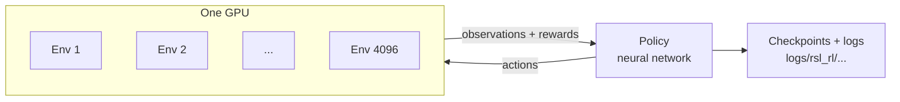

# 02 Isaac Lab

## English

**Category:** open-source robot-learning framework (RL, imitation learning, teleoperation, policy post-training) on top of GPU-parallel simulation. **Relevance:** high – this is the actual *training* workload that consumes cloud GPUs.

### What it is

Isaac Lab is **not a simulator itself**. It is a framework for building robot-learning applications *on top of* a simulator.

Core idea: **massive GPU parallelism**. Instead of one robot trying something once, the GPU simulates **thousands of copies of the robot at the same time** ("vectorized environments", set with `--num_envs`, e.g. 4096). Each copy explores differently; the experience is collected in a batch and used to update one shared policy.



### Multi-backend architecture (new in 3.0)

| Layer | Options | Note |
|---|---|---|
| Physics | **Newton** (Warp-based, MJWarp and other solvers), **OvPhysX** (standalone PhysX), **Isaac Sim PhysX** (full Kit) | Newton is in the default install and can run **without Isaac Sim** ("kit-less") |
| Camera rendering | Newton Tiled Camera (fast, lower fidelity), **OvRTX** (standalone RTX), **Isaac RTX** (full Isaac Sim) | Physics, rendering and visualization are separate choices |
| Configuration | Hydra configs + presets, e.g. `physics=newton_mjwarp renderer=newton_renderer` | Same task can run on different backends if presets exist |

Cloud implication: a **kit-less Newton** setup is much lighter than a full Isaac Sim installation. The strict RT-core requirement is documented for Isaac Sim; for kit-less paths check the Isaac Lab installation docs before choosing a GPU (see [[03-Hardware-and-GPU-Selection]]).

### Two ways to write environments

- **Manager-based:** composable managers for observations, rewards, terminations, events (randomization), curriculum, commands, actions, recorders – modular, good for research.
- **Direct:** one class implements `_get_observations`, `_get_rewards`, `_get_dones`, `_reset_idx` – simpler, Isaac Gym style.
- Both expose a standard **Gymnasium** `Env` interface → work with any supported RL library.

### Supported learning libraries

| Library | Typical use |
|---|---|
| **RSL-RL** (default) | GPU-parallel locomotion and manipulation, PPO, teacher-student distillation |
| **skrl** | PyTorch, JAX or Warp; multi-agent (MAPPO, IPPO) |
| **RL-Games** | Existing RL-Games projects, population-based training, Ray integration |
| **Stable-Baselines3** | Familiar baselines, smaller experiments |
| **TorchRL** | Custom algorithms from PyTorch-native components |
| **RLinf** | RL post-training of Vision-Language-Action (VLA) models, e.g. GR00T, OpenVLA |

### Bundled robots and tasks (examples)

Cartpole, Ant, Humanoid, UR10, Franka, Allegro hand, Shadow hand, ANYmal B/C/D, Unitree A1/Go1/Go2/H1/G1, Spot, Crazyflie quadcopter.

### Basic commands (Isaac Lab 3.0 docs)

```bash
# smoke test without learning
uv run isaaclab random_agent --task Isaac-Cartpole --num_envs 16

# train (headless by default) – checkpoints + TensorBoard logs under logs/rsl_rl/
uv run isaaclab train --rl_library rsl_rl --task Isaac-Cartpole

# evaluate the latest checkpoint in a visualizer
uv run isaaclab play --rl_library rsl_rl --task Isaac-Cartpole --checkpoint latest --num_envs 32

# record a video of the trained policy (useful on a headless cloud VM)
uv run --extra video isaaclab play --rl_library rsl_rl --task Isaac-Cartpole --checkpoint best --video --video_length 200
```

- Older/alternative wrapper syntax still appears in tutorials, e.g. `./isaaclab.sh train --rl_library skrl --task Isaac-Ant-v0 --headless` and `--livestream 2` for streaming the viewport.
- `--checkpoint pretrained` downloads published checkpoints for selected core tasks.
- Experiment tracking: TensorBoard (default) or **Weights & Biases** (`--logger wandb`) – handy when the training runs on a remote cloud machine and the team wants to watch the curves online.

### Why it is a natural cloud workload

- **Training = headless batch job:** no GUI needed, runs for hours, produces files (checkpoints, logs, videos) → classic "rent, run, download, shut down" pattern.
- **Watching = interactive:** needs rendering + streaming → different setup ([[04-Remote-Access-and-Streaming]]).
- **Scales out:** multi-GPU and multi-node training, HPC clusters, OSMO and Ray.
- Isaac Lab needs **more RAM and VRAM** than plain Isaac Sim; out-of-memory is fixed first by reducing `--num_envs`.

### Applications built on Isaac Lab

- **Isaac Lab Arena:** composes scenes, robots and tasks into benchmarks to evaluate generalist robot policies.
- **Isaac GR00T workflows:** demonstration collection, synthetic trajectories, training and evaluation of humanoid foundation models.

### Best seminar sentence

"Isaac Lab turns one GPU into a gym with thousands of robots training at the same time – training is a headless batch job, which is exactly what the cloud is good at."

**Primary sources:** [Isaac Lab documentation](https://isaac-sim.github.io/IsaacLab/main/index.html), [Isaac Lab ecosystem page](https://isaac-sim.github.io/IsaacLab/main/source/isaaclab/ecosystem.html), [Reinforcement learning guide](https://isaac-sim.github.io/IsaacLab/main/source/concepts/reinforcement_learning.html), [Isaac Lab GitHub](https://github.com/isaac-sim/IsaacLab), [Isaac Lab technical report (arXiv 2511.04831)](https://arxiv.org/abs/2511.04831).

---
