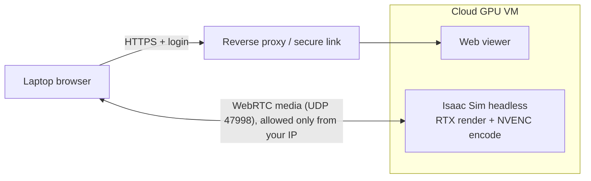

# 04 Remote Access and Streaming

## English

**Category:** access pattern for graphical GPU workloads on cloud servers. **Relevance:** high – explains *how a user sees and controls* a simulator that runs on a GPU far away.

### The core idea: headless + stream

A cloud GPU VM has no monitor. Isaac Sim therefore runs **headless** (no local window) and either:

1. **streams only the application window** (WebRTC, low latency, GPU-encoded with NVENC), or
2. is shown inside a **full remote desktop** of the VM (noVNC, NoMachine, Amazon DCV).

The GPU stays in the data center – only pixels and mouse/keyboard events travel over the network. That is why a normal laptop is enough on the user side.

### Access methods compared

| Method | What you see | Client | Used by |
|---|---|---|---|
| **Isaac Sim WebRTC Streaming Client** | Isaac Sim window | Native app (Windows, macOS, Linux) | Docs: best for local / same network |
| **Web viewer (Docker Compose)** | Isaac Sim window | Any Chromium browser, port 8210 | Docs: recommended for cloud and remote |
| **Kit App Streaming web viewer behind nginx** | Isaac Sim window at `<url>/viewer` | Browser | [[05-Isaac-Launchable-on-Brev]] |
| **noVNC / NoMachine** | Full Linux desktop | Browser / NoMachine app | [[06-Isaac-Automator]] |
| **Amazon DCV** | Full desktop, port 8443 | DCV client or browser | AWS Marketplace image, [[07-Isaac-Sim-on-Public-Clouds]] |
| **SSH / VS Code** | Terminal and files only | SSH client / browser IDE | Headless training ([[02-Isaac-Lab]]) |

### Constraints

- **One streaming method and one client per Isaac Sim instance** at a time → not a multi-user collaboration tool by itself.
- Requires a GPU with **NVENC** (hardware video encoder). A100 has none → no livestream.
- The Docker Compose web viewer is supported on Ubuntu hosts and DGX Spark only (not Windows/WSL).
- Latency depends on the distance to the cloud region → choose a region close to the user.

### Security (very important for the cloud part)

The Isaac Sim docs explicitly warn: the streaming endpoints have **no authentication and no encryption**. They are meant for private or trusted networks. In the cloud this means:

- Restrict ports in the **security group / firewall** to your own IP (`<your-ip>/32`), never `0.0.0.0/0`.
- For broader access put a **reverse proxy with HTTPS/TLS and authentication** in front (e.g. nginx).
- This is exactly what the managed options do for you:
  - Isaac Launchable: nginx + Brev **secure links** with NVIDIA login.
  - Isaac Automator: `--ingress-cidrs myip` limits access to your IP.
- Shared-responsibility model: the provider secures the data center; **you** are responsible for open ports and exposed services.

### Best seminar sentence

"In the cloud the simulator runs headless on the GPU and only a video stream comes to your browser – convenient, but the stream itself is unauthenticated, so you must lock the ports down or use a proxy with login."

**Primary sources:** [Isaac Sim livestream clients](https://docs.isaacsim.omniverse.nvidia.com/6.2.0/installation/manual_livestream_clients.html), [Isaac Sim AWS deployment](https://docs.isaacsim.omniverse.nvidia.com/6.2.0/installation/install_advanced_cloud_setup_aws.html), [Isaac Sim Brev deployment](https://docs.isaacsim.omniverse.nvidia.com/6.2.0/installation/install_advanced_cloud_setup_brev.html), [Isaac Sim Docker README](https://github.com/isaac-sim/IsaacSim/blob/main/tools/docker/README.md).

---
