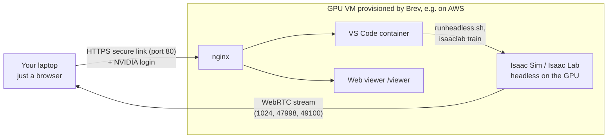

# 05 Isaac Launchable on Brev

## English

**Category:** one-click, browser-based cloud development environment (NVIDIA Brev Launchable). **Relevance:** high – the easiest documented way to use Isaac Sim and Isaac Lab without owning a GPU or a cloud account at AWS/GCP/Azure. Intended for **learning and experimenting**, not production.

### What a Launchable is

NVIDIA **Brev** provides GPU instances on several underlying cloud providers, preconfigured with drivers, CUDA, Docker and Jupyter. A **Launchable** bundles *hardware + software + code* into a **shareable one-click link**. The **Isaac Launchable** (GitHub `isaac-sim/isaac-launchable`, release v1.7 at research date) is such a template for Isaac.

### Architecture

Everything runs as **Docker containers** (Docker Compose) on one GPU VM:

| Container | Role |
|---|---|
| `isaac-lab-vscode` | VS Code in the browser – terminal, files, upload your robot |
| Isaac Sim 6.0.1 + Isaac Lab 3.0 (beta) | The workload, runs headless on the GPU |
| `isaac-lab-viewer` | Web viewer (Omniverse Kit App Streaming client) |
| `isaac-lab-nginx` | Reverse proxy routing `/` to VS Code and `/viewer` to the stream |

### Steps (official Launchable)

1. Open the Launchable page → **Deploy Launchable** → Brev starts the GPU VM (first start takes a while: image pull, caches).
2. On the instance page: **Using Secure Links** → open the link → log in with an NVIDIA account.
3. VS Code opens in the browser (tab 1).
4. In the VS Code terminal start Isaac Sim headless: `/isaac-sim/runheadless.sh` → wait for "app ready".
5. Open a second tab with the same URL + `/viewer` → the full Isaac Sim GUI, streamed via WebRTC (tab 2).
6. Use Isaac Lab from the VS Code terminal (train headless, then play and watch in the viewer).
7. Upload your own robot (URDF/USD) into the VS Code workspace and load it in Isaac Sim.
8. **Stop** the instance when done. Billing is per hour while running; a stopped instance only costs storage.

### Custom Launchable (own configuration)

- Brev → *Create Launchable* → **VM mode**.
- Setup script: `git clone https://github.com/isaac-sim/isaac-launchable && cd isaac-launchable/isaac-lab && docker compose up -d`.
- Optional environment variable `VSCODE_PASSWORD`.
- Secure link named "isaac" on **port 80**; open TCP/UDP **1024, 47998, 49100** for streaming.
- Choose a GPU **with RT cores** (e.g. L40S, RTX PRO 6000) and enough disk.
- Known limits: **not compatible with Crusoe** as provider; tested on **AWS**.
- Local use is possible too: install `nvidia-container-toolkit`, set `ENV=localhost`, run `docker compose up -d`.

### Cost observation

During our research (Nov 2026) the official Isaac Launchable configuration was shown at roughly **US$ 3 per hour** in the Brev console. Prices depend on GPU type, provider and time – always check the live price before deploying and stop the instance afterwards.

### Alternative on Brev without the Launchable

The Isaac Sim docs also describe a plain Brev VM: create an instance with **1× L40S**, expose ports 49100, 47998, 8210 **only to your IP**, open the Jupyter terminal, then start Isaac Sim with Docker Compose and its web viewer on port 8210 (see [[04-Remote-Access-and-Streaming]]).

### Strengths

- No local GPU, no own AWS/GCP/Azure account, no manual driver/Docker setup.
- Browser-only: IDE + streamed simulator.
- Secure link with login instead of an open, unauthenticated stream port.
- Shareable: the whole class/team can deploy the same environment.

### Limitations

- Learning/prototyping tool, not a production or large-scale training platform.
- Single VM
- Versions inside the Launchable can lag behind the newest Isaac Sim/Isaac Lab releases.

### Best seminar sentence

"A Launchable is a cloud template: one click gives you a GPU VM with VS Code and a streamed Isaac Sim in the browser – you pay by the hour and switch it off afterwards."

**Primary sources:** [Isaac Launchable repository](https://github.com/isaac-sim/isaac-launchable), [Isaac Sim docs – Isaac Launchable deployment](https://docs.isaacsim.omniverse.nvidia.com/6.0.1/installation/install_advanced_cloud_setup_launchable.html), [Isaac Sim docs – Brev deployment](https://docs.isaacsim.omniverse.nvidia.com/6.2.0/installation/install_advanced_cloud_setup_brev.html), [NVIDIA Brev documentation](https://docs.nvidia.com/brev/latest/), [Video walkthrough](https://www.youtube.com/watch?v=2XEbhfXNYM4).

---
