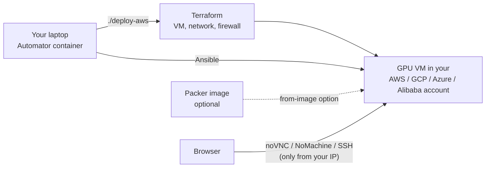

# 06 Isaac Automator

## English

**Category:** open-source Infrastructure-as-Code (IaC) deployment tool for GPU workstations in your own public-cloud account. **Relevance:** high – shows how a reproducible Isaac environment is provisioned on AWS, GCP, Azure or Alibaba Cloud with standard DevOps tools.

### What it is

Isaac Automator (GitHub `isaac-sim/IsaacAutomator`, v4.6.x at research date) deploys an **"Isaac Workstation"**: a GPU VM with remote desktop and **Isaac Sim, Isaac Lab and Isaac Lab Arena** preinstalled, into **your own** cloud account. You pay the cloud provider directly.

### Under the hood

| Tool | Role |
|---|---|
| **Docker** | Automator itself runs in a container → no local tool installation |
| **Terraform** | Creates cloud resources: VM, network, firewall rules, public IP |
| **Ansible** | Configures the VM: drivers, Isaac Sim, Isaac Lab, desktop, demos |
| **Packer** | Optionally builds pre-baked VM images (`./image-aws`, `./image-azure`, `./image-gcp`) → faster deployments with `--from-image` |



### Lifecycle commands

```bash
./build                  # build the Automator container (once)
./run                    # enter the container
./deploy-aws             # or ./deploy-gcp, ./deploy-azure, ./deploy-alicloud (prompts for login)
./novnc <name>           # remote desktop in the browser (also ./ssh, NoMachine)
./upload <name>          # local uploads/  -> VM ~/uploads
./download <name>        # VM ~/results    -> local results/
./stop <name>            # stop VM, pay only storage
./start <name> [--quick] # start again, public IP is kept
./repair <name>          # re-run configuration
./destroy <name>         # delete everything
./import                 # import an existing deployment state
```

### Useful options

- `--instance-type …` – choose the VM size.
- `--isaacsim <ref|no>`, `--isaaclab <ref|no>`, `--isaaclab-arena <ref|no>` – pick versions or skip components.
- `--demos quadruped-locomotion,humanoid-locomotion,franka-manipulation` – preinstalled training demos.
- `--ingress-cidrs myip` – only your IP can reach the VM.
- `--existing ask|repair|modify|replace|run_ansible` – how to treat an existing deployment.
- `--prefix`, `--in-china` (mirrors for deployments in China).
- GCP: `--isaac-workstation-gpu-count 1|2|4|8` – N1 (up to 4× T4), G2 (up to 8× L4), G4 (up to 8× RTX PRO 6000).
- AWS g6e (L40S) and g7e (RTX PRO 6000); Azure NCv6; Alibaba A100/A10/T4 (no vGPU).

### Operational details

- Cloud credentials and Terraform state are kept in `state/` → **never commit this folder** to git.
- `autorun.sh` runs on VM start (automation hook).
- The repo ships documentation for AI coding agents (`AGENTS.md`).
- Older Isaac Lab 2.2 docs required an **NGC API key** (`docker login nvcr.io`, user `$oauthtoken`); the v4 README no longer mentions it.

### Strengths

- Reproducible: the same command creates the same environment ("cattle, not pets").
- Works across four clouds; you keep control of account, region, budget and data.
- Clean cost control via `stop`/`start`/`destroy`.
- Multi-GPU workstations possible (e.g. GCP up to 8 GPUs).

### Limitations

- Requires your own cloud account, GPU quotas and some DevOps understanding.
- Single workstation per deployment, not an auto-scaling training cluster.
- Remote desktop is heavier than the Launchable's pure app stream.

### Best seminar sentence

"Isaac Automator is Infrastructure as Code for robotics: Terraform builds the GPU VM, Ansible installs Isaac – one command to deploy, one to stop, one to destroy."

**Primary sources:** [Isaac Automator repository](https://github.com/isaac-sim/IsaacAutomator), [Isaac Lab cloud deployment docs](https://isaac-sim.github.io/IsaacLab/main/source/features/cloud_deployment.html), [Isaac Sim cloud deployment overview](https://docs.isaacsim.omniverse.nvidia.com/6.2.0/installation/install_cloud.html).

---
