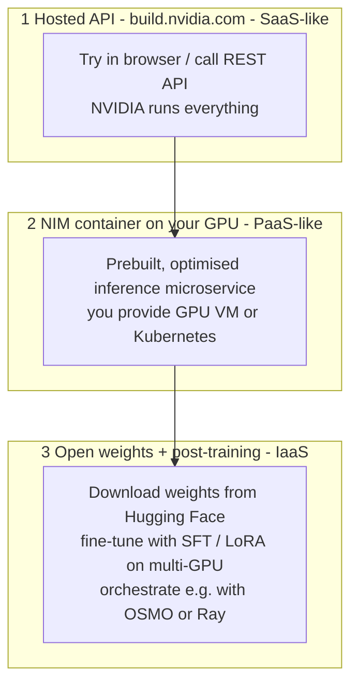
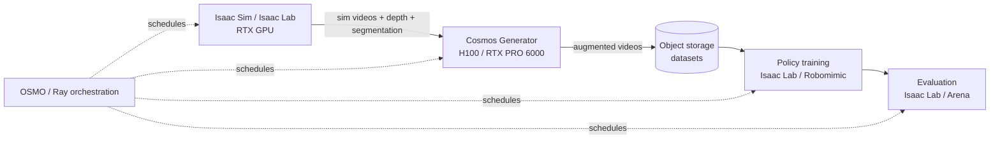

# 10 Cosmos in the Cloud

## English

**Category:** consumption models for large generative models (hosted API, self-hosted inference microservice, open weights + post-training on clusters). **Relevance:** high – Cosmos is a textbook example of the cloud service models taught in the course.

### Why Cosmos is a cloud workload

- The models are **pretrained** – nobody in a student project trains them from scratch. But **inference is still heavy**: Nano (16B) needs RTX PRO 6000 / H100 / B200, Super (64B) needs H200 / B200 / GB200 (see [[09-Cosmos-World-Foundation-Models]]).
- Generating thousands of augmented videos is a **large batch job** that runs for hours and then is finished → perfect for renting GPUs temporarily.
- These are **other GPUs than Isaac Sim needs** (RT cores vs. big AI GPUs) → one robotics pipeline, several hardware profiles ([[03-Hardware-and-GPU-Selection]]).

### Three levels of access

| Level | You manage | NVIDIA / provider manages | Good for |
|---|---|---|---|
| **1 Hosted API** (build.nvidia.com) | prompts, inputs, API key | models, GPUs, scaling | trying out, demos, small volumes |
| **2 NIM microservice** | GPU VM / Kubernetes, scaling, network, security | optimised container (TensorRT-LLM etc.), standard API | production inference, data privacy, predictable volume |
| **3 Open weights** | everything: GPUs, environment, training code, data | model weights + Cosmos Framework tools | custom post-training on own robot data |

Brev also documents **deploying NIMs on Brev instances**, so the same one-click idea as in [[05-Isaac-Launchable-on-Brev]] applies to Cosmos inference.

### Post-training in the cloud

- **Post-training** = adapting a pretrained model to your own domain (e.g. your robot, your factory) with **SFT** (supervised fine-tuning), **LoRA** (cheap low-rank fine-tuning), **RL** or **distillation** (smaller/faster model).
- Typically multi-GPU or multi-node jobs → cluster schedulers, **OSMO**, or **Ray** (cosmos-xenna pipelines).
- Data curation (Cosmos Curator) is itself a big, parallel data-processing job (video decoding, filtering, captioning).

### Pipeline view (link to Lucía's OSMO)

### Cost and governance considerations

- Hosted API: pay per use, no idle cost – but data leaves your environment.
- NIM / open weights: you pay for GPU hours (including idle time if not stopped), but keep data in your account.
- Licence: OpenMDW-1.1 for weights; guardrails enabled by default; check terms before commercial use.
- Generated data must be **validated** (Cosmos Evaluator / Reasoner, or by measuring policy success) – generated ≠ correct.

### Best seminar sentence

"Cosmos shows the classic cloud service levels in one product: try it as an API, run it yourself as a NIM container, or download the weights and post-train on a rented GPU cluster."

**Primary sources:** [Cosmos GitHub](https://github.com/NVIDIA/Cosmos), [build.nvidia.com](https://build.nvidia.com/), [NVIDIA NIM](https://developer.nvidia.com/nim), [Brev – deploying NIMs](https://docs.nvidia.com/brev/guides/inference-deployment/deploying-nims), [NVIDIA OSMO](https://developer.nvidia.com/osmo), [Cosmos product page](https://www.nvidia.com/en-us/ai/cosmos/).

---
